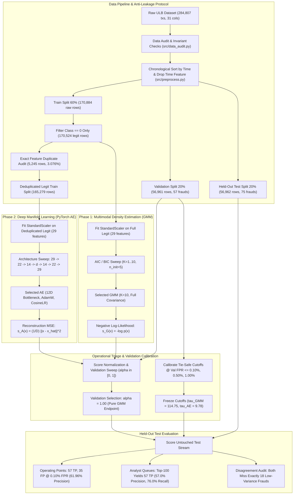

# Card Fraud Triage: Unsupervised Density Estimation & Deep Manifold Learning

<div align="center">


**An End-to-End Operational Fraud Triage Pipeline Combining Full-Covariance Gaussian Mixture Models (Phase 1) and Deep Autoencoders (Phase 2) under Strict False-Positive Budgets and Analyst Queue Constraints.**

</div>

---

## Executive Summary

Credit card fraud detection operates under extreme class imbalance (`0.173%` positive fraud rate, or a `577.9 : 1` legitimate-to-fraud ratio) and non-stationary adversarial behavior. In production payment processing, conventional supervised classifiers trained on historical fraud labels overfit to known attack signatures, decay rapidly under concept drift, and cause unacceptable customer friction (false declines).

This repository implements a **two-phase unsupervised anomaly detection and triage framework**:
- **Phase 1 (Multimodal Density Estimation):** A 10-component full-covariance Gaussian Mixture Model (GMM) fitted strictly on chronologically prior legitimate transactions, ranking incoming events by negative log-likelihood ($s_G(\mathbf{x}) = -\log p(\mathbf{x})$).
- **Phase 2 (Deep Nonlinear Manifold Learning):** A 12-dimensional bottleneck PyTorch Deep Autoencoder (AE) fitted on deduplicated legitimate feature vectors, scoring anomalies by Mean Squared Reconstruction Error ($s_A(\mathbf{x}) = \frac{1}{D}\|\mathbf{x} - \hat{\mathbf{x}}\|_2^2$).
- **Score Fusion & Operational Calibration:** Evaluates a standardized hybrid score blend ($s_H = \alpha z_G + (1-\alpha) z_A$) with $\alpha$ selected strictly by validation Average Precision (AP), and enforces tie-safe operating thresholds derived from validation legitimate transactions.

### Golden Held-Out Benchmark Results (56,962 Transactions, 75 Frauds)

All detectors are trained exclusively on legitimate historical transactions and evaluated on the final 20% chronological test window (`test.csv`):

| Model / Architecture | Paradigm | Test AP (PR-AUC) | Test ROC-AUC | Recall @ Val FPR $\le 0.10\%$ | Precision @ Val FPR $\le 0.10\%$ | Test Alerts (TP / FP) | Top-100 Precision / Recall |
| :--- | :--- | :---: | :---: | :---: | :---: | :---: | :---: |
| **Isolation Forest ($n=200$)** | Unsupervised Tree | `0.0358` | `0.9470` | `0.00%` (0/75) | `0.00%` | `42` (0 / 42) | `4.00%` / `5.33%` |
| **Single Gaussian ($K=1$)** | Unsupervised Mahalanobis | `0.1443` | `0.9594` | `0.00%` (0/75) | `0.00%` | `37` (0 / 37) | `26.00%` / `34.67%` |
| **Deep Autoencoder (12D Bottleneck)** | **Unsupervised Neural Manifold** | **`0.2453`** | **`0.9274`** | **`29.33%` (22/75)** | **`42.31%`** | **`52` (22 / 30)** | **`35.00%` / `46.67%`** |
| **Full-Covariance GMM ($K=10$, Ours)** | **Unsupervised Density Mixture** | **`0.4833`** | **`0.9106`** | **`76.00%` (57/75)** | **`61.96%`** | **`92` (57 / 35)** | **`57.00%` / `76.00%`** |
| **Validation-Selected Hybrid ($\alpha=1.00$)** | **Calibrated Standardized Blend** | **`0.4833`** | **`0.9106`** | **`76.00%` (57/75)** | **`61.96%`** | **`92` (57 / 35)** | **`57.00%` / `76.00%`** |
| *Logistic Regression (Balanced)* | *Supervised Reference Ceiling* | *`0.7438`* | *`0.9821`* | *`80.00%` (60/75)* | *`49.59%`* | *`121` (60 / 61)* | *`54.00%` / `72.00%`* |

*Note on Metric Conventions: Phase 2 reports scikit-learn non-interpolated Average Precision (AP = `0.4833` for GMM). Phase 1 evaluated trapezoidal PR-AUC (`auc(rec, prec) = 0.4736`). Operating cutoffs $\tau = 114.75$ (discrete order statistic) and $\tau = 114.62$ (interpolated 99.9th quantile) yield the exact same test classifications (57 TP, 35 FP, 18 FN, 56,852 TN).*

### Key Operational Insights
1. **The Deep Learning Trade-Off (Global ROC vs. Extreme-Tail Precision):** The Deep Autoencoder achieves the highest unsupervised global ranking discrimination (**0.9274 ROC-AUC**), learning a smooth, continuous manifold for the broad distribution. However, payment triage operates at the extreme tail ($\text{FPR} \le 0.10\%$); here, GMM's localized full-covariance components impose sharp negative log-likelihood penalties on interstitial outliers, delivering **$2.0\times$ the Average Precision** (**0.4833** vs. **0.2453**) and intercepting **57 vs. 22 frauds** at 0.10% FPR.
2. **Honest Hybrid Selection:** Validation AP sweep across blend weights $\alpha \in [0.0, 1.0]$ revealed monotonic degradation when mixing AE reconstruction error with GMM likelihood ($\text{Val AP: } 0.1222 \to 0.4782$). The pipeline selected $\alpha = 1.00$, refusing to deploy a diluted ensemble and preserving peak triage yield.
3. **Root Cause of the 18 Missed Frauds:** An exhaustive disagreement audit proved that all 22 frauds caught by the Autoencoder were also caught by GMM (0 AE-only hits), and both detectors missed the exact same 18 frauds. These 18 cases sit inside legitimate clusters in PCA space (median Amount $7.80, median V14 $-1.89, median V17 $+1.33). They represent a mathematical ceiling for PCA-based anomaly detection, requiring upstream contextual signals (device ID, IP velocity, merchant risk) rather than deeper models.

---

## Deliverables & Documentation

- **Executed Phase 1 Notebooks:**
  - [`notebooks/phase1_ml_01_eda_and_quality.ipynb`](notebooks/phase1_ml_01_eda_and_quality.ipynb) — Chronological EDA, class imbalance, and data invariants.
  - [`notebooks/phase1_ml_02_gmm_selection.ipynb`](notebooks/phase1_ml_02_gmm_selection.ipynb) — AIC/BIC model selection ($K=1\dots10$) and covariance analysis.
  - [`notebooks/phase1_ml_03_gmm_evaluation.ipynb`](notebooks/phase1_ml_03_gmm_evaluation.ipynb) — Validation calibration, bootstrap CIs, and baseline benchmarking.
- **Executed Phase 2 Notebooks:**
  - [`notebooks/phase2_dl_01_autoencoder_training.ipynb`](notebooks/phase2_dl_01_autoencoder_training.ipynb) — Deduplication ablation, bottleneck sweep ($d=4,8,12,16$), and feature attribution.
  - [`notebooks/phase2_dl_02_unsupervised_metrics.ipynb`](notebooks/phase2_dl_02_unsupervised_metrics.ipynb) — Intrinsic cluster geometry (Silhouette, DB, CH) and zero-label consensus pseudo-labels.
  - [`notebooks/phase2_dl_03_gmm_vs_ae_triage.ipynb`](notebooks/phase2_dl_03_gmm_vs_ae_triage.ipynb) — Validation blend selection, held-out PR/ROC curves, fixed-queue triage, and fraud profile audit.
- **Reports & Presentation:**
  - [Phase 2 Two-Column IEEE Conference Paper (PDF)](docs/phase2_dl_ieee/main.pdf) · [LaTeX Source](docs/phase2_dl_ieee/main.tex)
  - [Combined 20-Slide Presentation Deck (PDF)](docs/phase2_dl_presentation/Card_Fraud_Triage_Presentation.pdf) · [HTML Slide Deck](docs/phase2_dl_presentation/presentation.html)
  - [Phase 1 IEEE Technical Report (PDF)](docs/phase1_ml/card_fraud_triage_ieee.pdf)

---

## End-to-End Pipeline Architecture



---

## Repository Structure

```text
card-fraud-triage/
├── data/
│   ├── raw/
│   │   ├── .gitkeep                               # Directory anchor
│   │   └── creditcard.csv                         # Raw ULB dataset (284,807 rows, git-ignored)
│   └── processed/
│       ├── .gitkeep                               # Directory anchor
│       ├── train_legit.csv                        # 170,524 full legitimate rows x 29 features
│       ├── train_legit_dedup.csv                  # 165,279 distinct legitimate rows x 29 features
│       ├── val.csv                                # 56,961 validation rows x 30 cols (57 frauds)
│       └── test.csv                               # 56,962 test rows x 30 cols (75 frauds)
├── models/
│   ├── best_autoencoder.pt                        # Serialized PyTorch 12D AE state dict & architecture
│   ├── best_gmm.joblib                            # Serialized scikit-learn GMM (K=10, full covariance)
│   ├── scaler.joblib                              # StandardScaler fitted on full legitimate train
│   └── scaler_dedup.joblib                        # StandardScaler fitted on deduplicated legitimate train
├── notebooks/
│   ├── phase1_ml_01_eda_and_quality.ipynb         # Phase 1: EDA, distributions & data invariants
│   ├── phase1_ml_02_gmm_selection.ipynb           # Phase 1: GMM component sweep & BIC minimization
│   ├── phase1_ml_03_gmm_evaluation.ipynb          # Phase 1: Validation calibration & baseline benchmarks
│   ├── phase2_dl_01_autoencoder_training.ipynb    # Phase 2: AE training, deduplication ablation & attribution
│   ├── phase2_dl_02_unsupervised_metrics.ipynb    # Phase 2: Intrinsic geometry & pseudo-label consensus
│   └── phase2_dl_03_gmm_vs_ae_triage.ipynb        # Phase 2: Hybrid selection, queues & error analysis
├── docs/
│   ├── phase1_ml/
│   │   ├── Card_Fraud_Triage_Presentation.pdf     # Phase 1 slide deck (12 slides)
│   │   ├── card_fraud_triage_ieee.pdf             # Phase 1 technical paper
│   │   ├── card_fraud_triage_ieee.tex             # Phase 1 LaTeX source
│   │   └── presentation.html                      # Phase 1 HTML presentation
│   ├── phase2_dl_ieee/
│   │   ├── figures/                               # Attribution, convergence & test PR/ROC curves
│   │   ├── tables/                                # Modular LaTeX tables (ablation, sweep, triage)
│   │   ├── main.pdf                               # Phase 2 IEEE conference paper (4 pages)
│   │   └── main.tex                               # Phase 2 LaTeX source
│   └── phase2_dl_presentation/
│       ├── figures/                               # High-res curve assets
│       ├── Card_Fraud_Triage_Presentation.pdf     # Combined Phase 1 + Phase 2 slide deck (20 slides)
│       └── presentation.html                      # Phase 2 HTML presentation source
├── src/
│   ├── __init__.py                                # Package marker
│   ├── autoencoder.py                             # PyTorch FraudAutoencoder model & training engine
│   ├── data_audit.py                              # Data ingestion, balance audit & assertion tests
│   ├── preprocess.py                              # Chronological pipeline, deduplication & splitting
│   └── unsupervised_metrics.py                    # Silhouette, DB, CH & pseudo-label consensus metrics
├── .gitignore
├── LICENSE
├── requirements.txt
└── README.md
```

---

## Data Engineering & Anti-Leakage Discipline

### 1. Strict Chronological Partitioning (No Lookahead Leakage)
Financial transactions are non-stationary time series. Shuffling data randomly causes future fraud patterns to contaminate training data. `src/preprocess.py` sorts all transactions strictly by elapsed `Time` before executing a `60% / 20% / 20%` chronological split:

| Partition | Total Rows | Legitimate (`Class=0`) | Fraud (`Class=1`) | Fraud Rate | Elapsed Time Interval | Primary Role |
| :--- | :---: | :---: | :---: | :---: | :---: | :--- |
| **Raw Dataset** | `284,807` | `284,315` | `492` | `0.173%` | `0s` to `172,792s` (~48.0 hrs) | Benchmark ingestion |
| **Train (Raw 60%)** | `170,884` | `170,524` | `360` *(dropped)* | `0.211%` | `0s` to `120,396s` (~33.4 hrs) | Pre-filtering raw partition |
| **Train Legit (Full)** | **`170,524`** | `170,524` | **`0`** | **`0.000%`** | `0s` to `120,396s` | Phase 1 GMM training |
| **Train Legit (Dedup)**| **`165,279`** | `165,279` | **`0`** | **`0.000%`** | `0s` to `120,396s` | Phase 2 Autoencoder training |
| **Validation (20%)** | **`56,961`** | `56,904` | `57` | `0.100%` | `120,396s` to `145,247s` (~6.9 hrs) | Threshold & blend calibration |
| **Held-Out Test (20%)**| **`56,962`** | `56,887` | `75` | `0.132%` | `145,248s` to `172,792s` (~7.6 hrs) | Final untouched benchmark |

### 2. Elimination of Temporal Covariate Shift (`Time`)
`Time` measures cumulative seconds from the first recorded transaction. Because chronological splits create non-overlapping timestamp windows, retaining `Time` as a feature causes severe covariate shift: models assign high anomaly scores to test transactions simply because their timestamps were never seen during training. Dropping `Time` after sorting forces both GMM and Autoencoder to learn true behavioral anomalies across the 29 features (`V1`-`V28` and `Amount`).

### 3. Duplicate Feature Audit & Ablation
`src/data_audit.py` revealed that while the raw dataset contains only 1,081 duplicate rows including timestamps, auditing the 29 behavioral features in legitimate training data revealed **5,245 duplicate feature vectors (3.076%)**. Repeated vectors overweight specific transaction modes in neural reconstruction loss.

An 8D Autoencoder ablation confirmed that deduplicating legitimate training data improved generalizability on unseen data:
- **Trained with Duplicates (170,524 rows):** Train MSE = `0.3471`, Val Legit MSE = `0.5953`.
- **Trained Deduplicated (165,279 rows):** Train MSE = `0.3506`, Val Legit MSE = **`0.5929`** (lower reconstruction error on legitimate validation transactions).

---

## Model Architectures & Selection

### 1. Phase 1: Full-Covariance Gaussian Mixture Model
Legitimate spending behavior is modeled as a mixture of $K$ multivariate Gaussian components estimated via Expectation-Maximization (EM):
$$p(\mathbf{x}) = \sum_{k=1}^K \pi_k \, \mathcal{N}(\mathbf{x} \mid \boldsymbol{\mu}_k, \boldsymbol{\Sigma}_k), \qquad s_G(\mathbf{x}) = -\log p(\mathbf{x})$$
where $\pi_k > 0$, $\sum_k \pi_k = 1$, $\boldsymbol{\mu}_k \in \mathbb{R}^{29}$, and $\boldsymbol{\Sigma}_k \in \mathbb{R}^{29 \times 29}$ are full unconstrained covariance matrices regularized by $\lambda = 10^{-6}$.

Evaluating Bayesian Information Criterion ($\text{BIC} = P\ln N - 2\ln\hat{L}$) across $K=1 \dots 10$ selected **$K=10$** ($\text{BIC} = -9,773,479.62$, $\Delta\text{BIC} = -1.02\times 10^6$ vs. $K=9$). Training with `n_init=5` ensured convergence beyond single-initialization EM local optima.

### 2. Phase 2: PyTorch Deep Autoencoder
The Autoencoder maps 29 standardized features through a symmetric nonlinear bottleneck:
$$\mathbf{z} = f_\theta(\mathbf{x}) \in \mathbb{R}^d, \qquad \hat{\mathbf{x}} = g_\phi(\mathbf{z}) \in \mathbb{R}^{29}, \qquad s_A(\mathbf{x}) = \frac{1}{29} \sum_{j=1}^{29} (x_j - \hat{x}_j)^2$$
- **Layers:** $\text{Linear}(29 \to 22) \to \text{BatchNorm} \to \text{LeakyReLU}(0.1) \to \text{Dropout}(0.10) \to \text{Linear}(22 \to 14) \to \text{BatchNorm} \to \text{LeakyReLU}(0.1) \to \text{Linear}(14 \to d)$
- **Decoder:** Symmetric reverse architecture with linear reconstruction output.
- **Optimization:** AdamW ($\text{lr}=10^{-3}$, $\text{weight\_decay}=10^{-4}$), Cosine Annealing, early stopping on legitimate validation loss.

#### Bottleneck & Denoising Sweep on Validation Split
| Architecture | Bottleneck ($d$) | Noise Std ($\sigma$) | Parameters | Train MSE | Val Legit MSE | Val AP | Val ROC-AUC | Outcome |
| :--- | :---: | :---: | :---: | :---: | :---: | :---: | :---: | :--- |
| **AE ($d=4$)** | 4 | 0.00 | 2,253 | `0.4907` | `0.7418` | `0.0478` | `0.9357` | Underfitting bottleneck |
| **AE ($d=8$)** | 8 | 0.00 | 2,369 | `0.3506` | `0.5929` | `0.0683` | `0.9449` | Baseline compression |
| **AE ($d=12$)** | **12** | **0.00** | **2,485** | **`0.2967`** | **`0.4860`** | **`0.1222`** | **`0.9467`** | **Optimal: Lowest Val MSE & Highest Val AP** |
| **AE ($d=16$)** | 16 | 0.00 | 2,601 | `0.2884` | `0.5121` | `0.0785` | `0.9415` | Overfitting to train split |
| **DAE ($d=8$)** | 8 | 0.05 | 2,369 | `0.3654` | `0.6070` | `0.0616` | `0.9369` | Noise degraded precision |
| **DAE ($d=12$)** | 12 | 0.05 | 2,485 | `0.3068` | `0.5405` | `0.0846` | `0.9531` | High ROC, lower tail precision |

The standard **12D Autoencoder** minimized legitimate validation MSE (`0.4860`) and maximized validation Average Precision (`0.1222`).

---

## Intrinsic Unsupervised Geometry & Consensus

### 1. Manifold Clustering Quality (Zero Labels Used)
Evaluated on a fixed, seeded sample of 10,000 unlabeled test transactions:
- **Phase 1 GMM (29D Standardized Space, $K=10$):** Silhouette = `0.0364`, Davies–Bouldin = `4.4603`, Calinski–Harabasz = `168.82`.
- **Phase 2 Autoencoder (12D Latent Space, $K=10$):** Silhouette = **`0.1836`**, Davies–Bouldin = **`1.5472`**, Calinski–Harabasz = **`1048.19`**.

The 12D bottleneck compresses diffuse 29D coordinates into compact, well-separated geometric manifolds.

### 2. Purely Unsupervised Consensus Pseudo-Labels
Applying training-quantile anomaly thresholds (zero ground-truth labels used) across the test stream:
- **Spearman Rank Correlation** between GMM negative log-likelihood and AE reconstruction MSE: **$\rho = 0.5049$**.
- At the **99.9% training quantile** (Cutoffs: GMM = `86.735`, AE = `5.821`):
  - GMM flags `120` transactions; AE flags `88` transactions.
  - Inter-model agreement: Cohen's $\kappa = \mathbf{0.6918}$, Jaccard Overlap = $\mathbf{0.5294}$, flagging `72` consensus anomalies.
  - Post-hoc ground truth audit: The 72 consensus anomalies catch **34 true frauds** at **47.22% precision**, proving strong unsupervised alignment without label supervision.

---

## Operational Triage & Held-Out Test Evaluation

Evaluated on `test.csv` (`56,962` transactions: `75` fraud, `56,887` legitimate).

### 1. Performance Under Validation-Calibrated FPR Budgets
Operating thresholds are derived from the 56,904 legitimate validation transactions using order-statistic cutoffs to prevent threshold overshooting:

| Model | Val FPR Budget | Cutoff ($\tau$) | Test TP | Test FP | Actual Test FPR | Test Recall | Test Precision | Total Alerts |
| :--- | :---: | :---: | :---: | :---: | :---: | :---: | :---: | :---: |
| **GMM ($K=10$)** | **`0.10%`** | `114.75` | **`57 / 75`** | `35` | **`0.062%`** | **`76.00%`** | **`61.96%`** | **`92`** |
| GMM ($K=10$) | `0.50%` | `68.72` | `59 / 75` | `192` | `0.338%` | `78.67%` | `23.51%` | `251` |
| GMM ($K=10$) | `1.00%` | `60.69` | `59 / 75` | `346` | `0.608%` | `78.67%` | `14.57%` | `405` |
| **Autoencoder (12D)** | **`0.10%`** | `9.78` | **`22 / 75`** | `30` | **`0.053%`** | **`29.33%`** | **`42.31%`** | **`52`** |
| Autoencoder (12D) | `0.50%` | `3.06` | `53 / 75` | `141` | `0.248%` | `70.67%` | `27.32%` | `194` |
| Autoencoder (12D) | `1.00%` | `2.02` | `55 / 75` | `346` | `0.608%` | `73.33%` | `13.72%` | `401` |
| **Hybrid ($\alpha=1.00$)** | **`0.10%`** | `0.98` | **`57 / 75`** | `35` | **`0.062%`** | **`76.00%`** | **`61.96%`** | **`92`** |

*Key Triage Result:* At the tightest budget ($\le 0.10\%$ FPR), GMM catches **$2.6\times$ more frauds** (57 vs. 22) than the Autoencoder at higher precision (61.96% vs. 42.31%).

### 2. Fixed Analyst Alert Queue Review (`Precision@K` & `Recall@K`)
When an AML operations team inspects a fixed capacity of the $K$ highest-scoring transactions:

| Queue Capacity ($K$) | GMM True Frauds | GMM Prec@K / Rec@K | AE True Frauds | AE Prec@K / Rec@K | GMM Lift vs Random (`0.132%`) |
| :---: | :---: | :---: | :---: | :---: | :---: |
| **Top-50** | **`29 / 75`** | **`58.00%` / `38.67%`** | `20 / 75` | `40.00%` / `26.67%` | **440.5x** |
| **Top-100** | **`57 / 75`** | **`57.00%` / `76.00%`** | `35 / 75` | `35.00%` / `46.67%` | **432.9x** |
| **Top-200** | **`58 / 75`** | **`29.00%` / `77.33%`** | `53 / 75` | `26.50%` / `70.67%` | **220.3x** |
| **Top-500** | **`59 / 75`** | **`11.80%` / `78.67%`** | `59 / 75` | `11.80%` / `78.67%` | **89.6x** |

In the Top-100 queue, GMM achieves **57.00% precision** (intercepting 57 frauds in 100 reviews), while AE retrieves 35. Both converge at $K=500$, catching 59 frauds.

---

## Disagreement Analysis & Feature Root Cause

### 1. Fraud Overlap Matrix (Across 75 Test Frauds)
| Operating Rule | Intercepted by Both | Caught by GMM Only | Caught by AE Only | Missed by Both |
| :--- | :---: | :---: | :---: | :---: |
| **Validation FPR $\le 0.10\%$** | `22` | `35` | **`0`** | `18` |
| **Top-100 Review Queue** | `35` | `22` | **`0`** | `18` |

Under both operational criteria:
- **Zero AE-only hits:** The Autoencoder never catches a single fraud that GMM misses.
- **Shared Misses:** Both models miss the **exact same 18 fraud cases**.

### 2. Feature Attribution & Missed Fraud Profiles
Decomposing Autoencoder reconstruction error revealed the top features driving fraud separation:
- **V14:** Fraud MSE = `39.00` vs. Legit MSE = `0.32` (**`123.28x` ratio**)
- **V17:** Fraud MSE = `34.25` vs. Legit MSE = `0.25` (**`137.34x` ratio**)
- **V12:** Fraud MSE = `16.52` vs. Legit MSE = `0.28` (**`59.79x` ratio**)

Comparing median feature values [with IQR] across fraud subgroups reveals why the 18 cases are missed:

| Subgroup | $n$ | Amount ($) | V14 Coordinate | V17 Coordinate | V12 Coordinate | Diagnosis |
| :--- | :---: | :---: | :---: | :---: | :---: | :--- |
| **Both Caught** | 22 | `$1.00` [0.77, 3.79] | **`-11.93`** [-13.15, -8.60] | **`-5.73`** [-6.54, -3.52] | **`-6.40`** [-7.93, -5.98] | Extreme anomalies in V14/V17 |
| **GMM Only** | 35 | `$10.70` [0.98, 139.34] | **`-6.28`** [-8.49, -4.84] | **`-2.52`** [-4.31, -1.38] | **`-3.81`** [-4.84, -3.05] | Moderate multivariate outliers |
| **Missed by Both** | 18 | **`$7.80`** [2.28, 36.89] | **`-1.89`** [-2.97, -0.46] | **`+1.33`** [0.41, 2.24] | **`-0.17`** [-0.50, 0.47] | **Inseparable in PCA space** |

**Engineering Finding:** The 18 missed frauds do not exhibit extreme values in V14, V17, or V12 and have standard retail amounts ($7.80 median). They reside directly within the high-density legitimate manifold. No model operating solely on these 29 PCA features can detect them without raising thousands of false alarms.

---

## Production Multi-Model Inference Snippet

This production-ready snippet loads the trained models and scalers, computes both scores, normalizes them, and outputs binary triage decisions:

```python
from pathlib import Path
import joblib
import numpy as np
import pandas as pd
import torch
from src.autoencoder import FraudAutoencoder
from src.preprocess import FEATURE_COLS

MODEL_DIR = Path("models")

# 1. Load Preprocessing Scalers
scaler_gmm = joblib.load(MODEL_DIR / "scaler.joblib")
scaler_ae = joblib.load(MODEL_DIR / "scaler_dedup.joblib")

# 2. Load Phase 1 GMM & Phase 2 PyTorch Autoencoder
gmm = joblib.load(MODEL_DIR / "best_gmm.joblib")
ckpt = torch.load(MODEL_DIR / "best_autoencoder.pt", map_location="cpu", weights_only=True)
ae = FraudAutoencoder(
    input_dim=len(FEATURE_COLS),
    hidden_dims=ckpt["hidden_dims"],
    latent_dim=ckpt["latent_dim"],
    dropout_rate=ckpt["dropout_rate"],
)
ae.load_state_dict(ckpt["state_dict"])
ae.eval()

# 3. Production Calibration Thresholds (Val FPR <= 0.10%)
GMM_CUTOFF = 114.75   # Phase 1 density cutoff (61.96% Precision, 76.00% Recall)
AE_CUTOFF = 9.7803    # Phase 2 reconstruction MSE cutoff


def score_transaction_stream(incoming_df: pd.DataFrame) -> pd.DataFrame:
    """
    Score incoming payment stream through both GMM and Autoencoder models.
    Returns individual anomaly scores and validated binary triage alerts.
    """
    X_raw = incoming_df[FEATURE_COLS].to_numpy()
    
    # Feature Standardization
    X_gmm = scaler_gmm.transform(X_raw)
    X_ae = scaler_ae.transform(X_raw)
    
    # Anomaly Scoring
    gmm_nll = -gmm.score_samples(X_gmm)
    ae_mse = ae.reconstruction_errors(X_ae, batch_size=2048)
    
    results = incoming_df.copy()
    results["gmm_score"] = gmm_nll
    results["ae_score"] = ae_mse
    
    # Operational Alert Rules
    results["alert_gmm_01pct"] = (gmm_nll >= GMM_CUTOFF).astype(int)
    results["alert_ae_01pct"] = (ae_mse >= AE_CUTOFF).astype(int)
    results["alert_consensus"] = (results["alert_gmm_01pct"] & results["alert_ae_01pct"]).astype(int)
    
    return results
```

---

## Reproduction & Verification

### 1. Environment Setup
```bash
git clone https://github.com/palak22291/card-fraud-triage.git
cd card-fraud-triage
python -m venv venv
source venv/bin/activate  # On Windows: venv\Scripts\activate
pip install -r requirements.txt
```

### 2. Data Pipeline Execution
Place Kaggle's `creditcard.csv` into `data/raw/` and run:
```bash
python src/data_audit.py
python -m src.preprocess
```

### 3. Notebook Execution (Headless)
Reproduce all experiments and save outputs in place:
```bash
jupyter nbconvert --to notebook --execute --inplace notebooks/phase1_ml_01_eda_and_quality.ipynb
jupyter nbconvert --to notebook --execute --inplace notebooks/phase1_ml_02_gmm_selection.ipynb
jupyter nbconvert --to notebook --execute --inplace notebooks/phase1_ml_03_gmm_evaluation.ipynb
jupyter nbconvert --to notebook --execute --inplace notebooks/phase2_dl_01_autoencoder_training.ipynb
jupyter nbconvert --to notebook --execute --inplace notebooks/phase2_dl_02_unsupervised_metrics.ipynb
jupyter nbconvert --to notebook --execute --inplace notebooks/phase2_dl_03_gmm_vs_ae_triage.ipynb
```

---

## Phase 3 Engineering Roadmap

1. **Upstream Contextual Features:** Overcoming the 18-fraud ceiling requires signals orthogonal to PCA coordinates: rolling velocity counters (e.g., number of cards used on device in last 1 hour), cross-border IP mismatch, and high-risk merchant category codes (MCCs).
2. **Semi-Supervised Active Learning:** Employing an active feedback loop where the 92 daily alerts reviewed by human analysts provide high-confidence labels to continuously fine-tune the decision boundary without full label supervision.
3. **Sliding-Window Online Adaptation:** Implementing streaming EM or continual learning on legitimate transactions to track seasonal shopping trends (e.g., Black Friday surges) without retraining from scratch.

---

## License

This project is open-source under the [MIT License](LICENSE).
