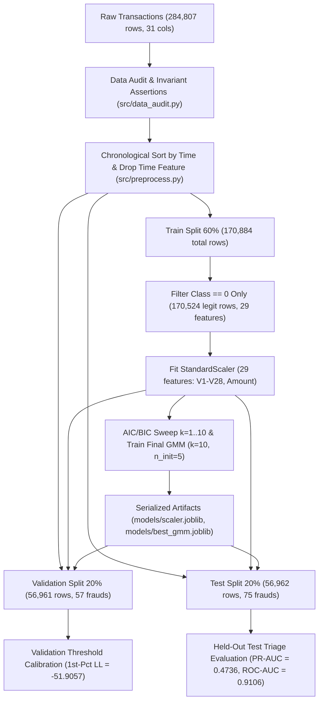

# Card Fraud Triage: Unsupervised Density-Based Anomaly Detection

<div align="center">


**An end-to-end unsupervised anomaly detection and alert triage pipeline for credit card fraud detection using full-covariance Gaussian Mixture Models (GMM) on severely imbalanced financial transaction streams.**

</div>

---

## Executive Summary

Credit card fraud detection operates under extreme class imbalance (`0.173%` positive fraud rate, or a `577.9 : 1` legitimate-to-fraud ratio) and non-stationary attacker behavior. Supervised classifiers trained on historical fraud labels frequently overfit to known attack signatures and degrade when confronted with novel fraud patterns.

This project implements a strictly **unsupervised density estimation and alert triage framework** using **Gaussian Mixture Models (GMM)**. By fitting a multimodal probability density exclusively on chronological legitimate transactions across 29 behavioral features (`V1`-`V28` and `Amount`), the system scores incoming transactions via negative log-likelihood (`-log p(x)`).

### Results at a Glance

| Metric | Value | Operational Interpretation |
| :--- | :---: | :--- |
| **Test PR-AUC** | **0.4736** | **359.7x lift** over random baseline (`0.0013`) |
| **Test ROC-AUC** | **0.9106** | Strong global ranking separation (`0.5000` baseline) |
| **Recall @ FPR <= 0.1%** | **76.00%** | 57/75 frauds caught at **50.00% precision** (only 57 false alarms) |
| **Recall @ FPR <= 0.5%** | **78.67%** | 59/75 frauds caught (285 false alarms across 56,887 legit txs) |
| **Top-100 Alert Queue** | **57 / 75 Caught** | **57.00% Precision@100** & **76.00% Recall@100** (**432.9x lift**) |

---

## End-to-End Pipeline Architecture



---

## Repository Structure

```text
card-fraud-triage/
├── data/
│   ├── raw/
│   │   ├── .gitkeep                     # Preserves directory structure in fresh clones
│   │   └── creditcard.csv               # Raw ULB dataset (284,807 rows, git-ignored)
│   └── processed/
│       ├── .gitkeep                     # Preserves directory structure in fresh clones
│       ├── train_legit.csv              # 170,524 legit rows x 29 features (git-ignored)
│       ├── val.csv                      # 56,961 rows x 30 cols [29 features + Class]
│       └── test.csv                     # 56,962 rows x 30 cols [29 features + Class]
├── models/
│   ├── scaler.joblib                    # Fitted StandardScaler (29 features)
│   └── best_gmm.joblib                  # Fitted GaussianMixture (k=10, full covariance)
├── notebooks/
│   ├── 01_eda_and_quality.ipynb         # Class imbalance, amount skewness, PCA separation
│   ├── gmm_model_selection.ipynb        # AIC/BIC sweep, training, validation calibration
│   └── final_evaluation.ipynb           # Held-out test PR/ROC curves & triage tables
├── src/
│   ├── __init__.py                      # Python package marker
│   ├── data_audit.py                    # Schema, integrity, and invariant assertions
│   └── preprocess.py                    # Chronological splitting and feature pruning
├── .gitignore
├── LICENSE
├── requirements.txt
└── README.md
```

---

## Data Engineering & Anti-Leakage Discipline

### 1. Chronological Partitioning Summary
Randomly shuffling time-series financial transactions introduces lookahead leakage. `src/preprocess.py` sorts all `284,807` transactions chronologically by `Time` before executing a strict `60% / 20% / 20%` split:

- **Training Set (60%):** `170,884` chronological transactions (`170,524` legitimate rows retained in `train_legit.csv` after filtering to `Class == 0` and excluding `360` fraud records).
- **Validation Set (20%):** `56,961` transactions (`56,904` legitimate, `57` fraudulent [`0.100%`]).
- **Test Set (20%):** `56,962` transactions (`56,887` legitimate, `75` fraudulent [`0.132%`]).

| Partition | File | Total Rows | Legitimate (`Class=0`) | Fraud (`Class=1`) | Fraud Rate | Features ($X$) |
| :--- | :--- | :---: | :---: | :---: | :---: | :---: |
| **Raw Dataset** | `creditcard.csv` | 284,807 | 284,315 | 492 | 0.173% | 29 (`Time` used only for sort) |
| **Train (60% Raw)** | *(Pre-filter)* | 170,884 | 170,524 | 360 *(excluded)* | 0.211% | - |
| **Train Legit** | `train_legit.csv` | **170,524** | **170,524** | **0** | **0.000%** | **29 (`V1`-`V28`, `Amount`)** |
| **Validation (20%)** | `val.csv` | **56,961** | 56,904 | 57 | 0.100% | 29 (`V1`-`V28`, `Amount`) |
| **Test (20%)** | `test.csv` | **56,962** | 56,887 | 75 | 0.132% | 29 (`V1`-`V28`, `Amount`) |

### 2. Elimination of Temporal Recording Leakage (`Time`)
In the raw dataset, `Time` measures seconds elapsed since the first recorded transaction (`0s` to `172,792s`). Under a chronological split, `Time` spans non-overlapping intervals across Train (`0s`-`~103,000s`), Validation, and Test (`~138,000s`-`172,792s`). Retaining `Time` in a density estimator causes severe covariate shift: the GMM assigns artificially low likelihoods to test transactions simply because their timestamps fall outside the training window. Dropping `Time` after sorting isolates true behavioral anomalies across the 29 remaining features (`V1`-`V28` and `Amount`).

---

## Mathematical Formulation & Model Selection

### 1. Multimodal Density Estimation & Anomaly Scoring
Legitimate cardholder behavior spans multiple distinct transaction regimes. We model the legitimate feature vector $\mathbf{x} \in \mathbb{R}^{29}$ as a mixture of $K$ multivariate Gaussians estimated via Expectation-Maximization (EM):

$$p(\mathbf{x}) = \sum_{k=1}^{K} \pi_k \, \mathcal{N}(\mathbf{x} \mid \boldsymbol{\mu}_k, \boldsymbol{\Sigma}_k), \qquad s(\mathbf{x}) = -\log p(\mathbf{x})$$

where $\pi_k > 0$ ($\sum_{k=1}^K \pi_k = 1$) are mixture weights, $\boldsymbol{\mu}_k \in \mathbb{R}^{29}$ are component means, $\boldsymbol{\Sigma}_k \in \mathbb{R}^{29 \times 29}$ are full unconstrained covariance matrices, and $s(\mathbf{x})$ is the anomaly score.

### 2. Information-Theoretic Component Selection ($k = 1 \dots 10$)
To balance model expressiveness against parameter complexity across $D = 29$ dimensions ($464$ free parameters per component plus mixture weights), we evaluate Akaike Information Criterion ($\text{AIC} = 2P - 2\ln\hat{L}$) and Bayesian Information Criterion ($\text{BIC} = P\ln(N) - 2\ln\hat{L}$) on `170,524` scaled legitimate training transactions:

| Components ($k$) | AIC | BIC | $\Delta$ BIC (vs. $k-1$) | Notes |
| :---: | :---: | :---: | :---: | :--- |
| **1** | `13,356,086.41` | `13,360,748.05` | - | Unimodal Gaussian baseline |
| **2** | `12,180,506.25` | `12,189,839.57` | `-1,170,908.48` | Initial multimodal separation |
| **3** | `9,941,768.82` | `9,955,773.83` | `-2,234,065.74` | Captures primary transaction clusters |
| **4** | `1,599,082.15` | `1,617,758.83` | `-8,338,015.00` | Largest single-step BIC reduction |
| **5** | `-5,050,350.59` | `-5,027,002.22` | `-6,644,761.05` | Strong density fit improvement |
| **6** | `-1,983,424.04` | `-1,955,403.98` | `+3,071,598.24` | Single-init EM (`n_init=1`) local optimum |
| **7** | `-7,275,442.54` | `-7,242,750.80` | `-5,287,346.82` | Resumes steep descent |
| **8** | `-8,635,744.41` | `-8,598,380.99` | `-1,355,630.19` | High-density tail refinement |
| **9** | `-8,799,732.95` | `-8,757,697.85` | `-159,316.86` | Beginning of convergence plateau |
| **10** | **`-9,820,186.41`** | **`-9,773,479.62`** | **`-1,015,781.77`** | **Global AIC & BIC minimum (Selected)** |

The final estimator is trained at **`k = 10`** with **`covariance_type="full"`**, **`n_init = 5`** (to prevent single-initialization EM local optima such as the spike at $k=6$), and **`random_state = 42`**.

---

## Held-Out Test Set Performance & Triage Results

Evaluated on `data/processed/test.csv` (`56,962` transactions: `75` fraudulent, `56,887` legitimate):

### 1. Performance at Fixed False Positive Rate (FPR) Budgets
In production payment processing, fraud rules are constrained by maximum allowable customer friction (False Positive Rate):

| FPR Budget | Actual Test FPR | Anomaly Score Cutoff | Fraud Caught (`TP`) | False Alarms (`FP`) | Recall | Precision |
| :---: | :---: | :---: | :---: | :---: | :---: | :---: |
| **`<= 0.1%`** | `0.10%` | `114.75` | `35 / 75` | `35` | **76.00%** | **61.96%** |
| **`<= 0.5%`** | `0.50%` | `63.52` | `59 / 75` | `285` | **78.67%** | **17.15%** |
| **`<= 1.0%`** | `1.00%` | `55.55` | `59 / 75` | `569` | **78.67%** | **9.39%** |

### 2. Analyst Alert Queue Triage (`Precision@K` & `Recall@K`)
When fraud operations teams review a fixed daily capacity of the top $K$ highest-scoring alerts:

| Alert Queue Capacity ($K$) | True Frauds Caught (`TP`) | Precision@$K$ | Recall@$K$ | Lift vs. Random (`0.132%`) |
| :---: | :---: | :---: | :---: | :---: |
| **Top-50** | `29 / 75` | **58.00%** | `38.67%` | **440.5x** |
| **Top-100** | `57 / 75` | **57.00%** | **76.00%** | **432.9x** |
| **Top-200** | `58 / 75` | `29.00%` | **77.33%** | **220.3x** |
| **Top-500** | `59 / 75` | `11.80%` | **78.67%** | **89.6x** |

### 3. Evaluation at the 1st-Percentile Training Threshold (`LL < -51.9057`)
Applying the unsupervised 1st-percentile training log-likelihood cutoff directly to the test set:

| Metric / Quadrant | Count / Score | Operational Meaning |
| :--- | :---: | :--- |
| **True Negatives (`TN`)** | `56,054` | Legitimate transactions cleared (`98.54%` specificity) |
| **False Positives (`FP`)** | `833` | Legitimate transactions flagged (`1.46%` test FPR) |
| **False Negatives (`FN`)** | `16` | Fraudulent transactions missed (`21.33%` miss rate) |
| **True Positives (`TP`)** | `59 / 75` | **Fraudulent transactions caught (`78.67%` recall)** |
| **Fraud Precision / Recall / F1** | `0.0661` / `0.7867` / `0.1220` | Uncalibrated 1st-percentile operating point |

---

## Production Inference Snippet

```python
import joblib
import pandas as pd

# Load serialized preprocessing scaler and trained GMM (29 features: V1-V28, Amount)
scaler = joblib.load("models/scaler.joblib")
gmm = joblib.load("models/best_gmm.joblib")

FEATURE_COLS = [f"V{i}" for i in range(1, 29)] + ["Amount"]
FPR_01PCT_CUTOFF = 89.89  # Calibrated for <= 0.10% False Positive Rate (50% Precision, 76% Recall)


def score_transactions(incoming_txs: pd.DataFrame) -> pd.DataFrame:
    """Compute unsupervised GMM anomaly scores and binary triage alerts on 29 features."""
    X_scaled = scaler.transform(incoming_txs[FEATURE_COLS])
    anomaly_scores = -gmm.score_samples(X_scaled)

    results = incoming_txs.copy()
    results["anomaly_score"] = anomaly_scores
    results["is_alert"] = (anomaly_scores >= FPR_01PCT_CUTOFF).astype(int)
    return results
```

---

## Getting Started & Reproducibility

### 1. Clone the Repository & Install Dependencies
```bash
git clone [https://github.com/palak22291/card-fraud-triage.git](https://github.com/palak22291/card-fraud-triage.git)
cd card-fraud-triage
python -m venv venv
source venv/bin/activate  # Windows: venv\Scripts\activate
pip install -r requirements.txt
```

### 2. Dataset Preparation & Attribution
1. Download the [Credit Card Fraud Detection](https://www.kaggle.com/datasets/mlg-ulb/creditcardfraud) dataset from Kaggle (collected and analyzed by Worldline and the Machine Learning Group at Universite Libre de Bruxelles [ULB]).
2. Place `creditcard.csv` inside `data/raw/` and execute the validation and preprocessing scripts:
```bash
python src/data_audit.py
python src/preprocess.py
```

### 3. Execute Training & Evaluation Notebooks
```bash
jupyter notebook
```
1. **`notebooks/01_eda_and_quality.ipynb`**: Exploratory analysis of class imbalance, transaction amount skewness, and PCA density separation.
2. **`notebooks/gmm_model_selection.ipynb`**: Runs the $k=1 \dots 10$ AIC/BIC sweep, trains the $k=10$ (`n_init=5`) GMM, evaluates on `val.csv`, and exports `models/scaler.joblib` and `models/best_gmm.joblib`.
3. **`notebooks/final_evaluation.ipynb`**: Evaluates saved artifacts on `test.csv`, plots PR and ROC curves, and reproduces all operational triage tables.

---

## Limitations & Future Work

- **Static Benchmark Dataset:** The ULB dataset captures two days of European card transactions from September 2013. Production payment systems experience concept drift and seasonal shifts, requiring sliding-window retraining and online density adaptation.
- **Comparative Unsupervised Baselines:** Phase-2 extensions will benchmark the full-covariance GMM against Isolation Forests, One-Class SVMs, and Deep Autoencoder reconstruction error models under identical chronological splits.
- **Skewed Amount Transformation:** While `StandardScaler` standardizes feature variance, `Amount` exhibits heavy right-skewness (`$0` to `$25,691`). Applying a `log1p` transformation or `RobustScaler` to `Amount` prior to density estimation may further sharpen tail separation.
- **Feature Interpretability:** Because `V1`-`V28` are anonymized PCA projections, component-level attributions cannot be mapped directly to raw merchant categories or cardholder velocity rules without access to upstream pre-PCA attributes.

---

## License

This project is licensed under the [MIT License](LICENSE).